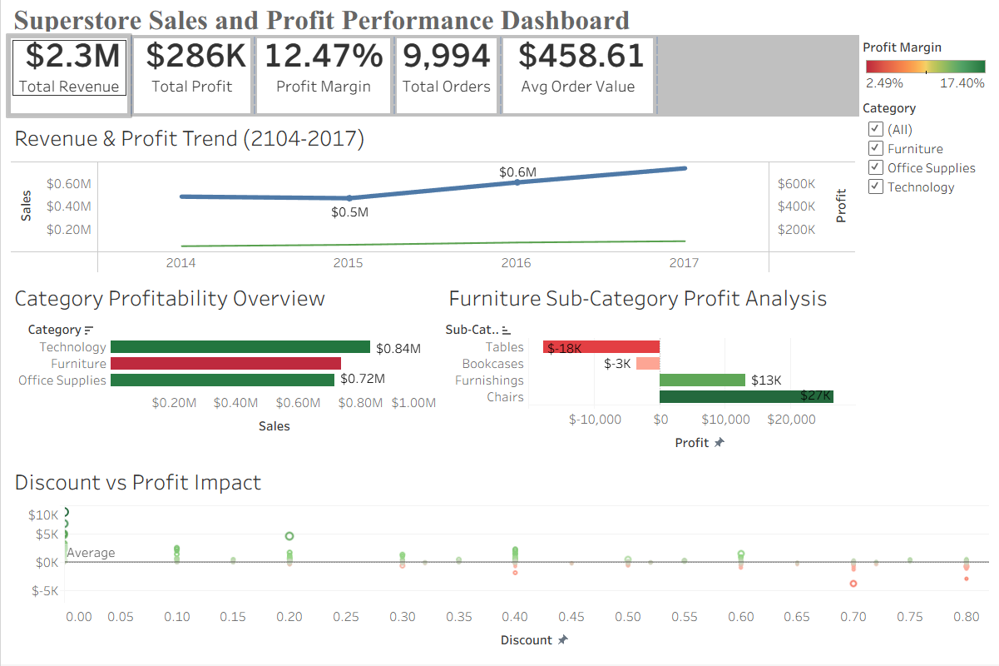

#  End-to-End Sales & Profitability Analysis Pipeline

##  Project Overview

This project performs an end-to-end sales and profitability analysis using the Superstore dataset.
The goal is to track business performance, identify profit leakage, and evaluate the impact of discount strategies on overall profitability.

The workflow integrates SQL for data analysis and Power BI for building an interactive dashboard, simulating a real-world data analytics pipeline.

---

##  Objectives

* Analyze sales, profit, and key business KPIs
* Identify high-performing and loss-making categories
* Perform sub-category level profitability analysis
* Evaluate the impact of discounting on profit
* Build an interactive dashboard for business insights

---

##  Dataset

* Source: Tableau's **Sample - Superstore** dataset (US retail orders)
* Total records: **9,994**
* Time period: **2014 – 2017**
* Total sales: **$2.3M+**

The dataset includes order details, product categories, sales, profit, and discount information.

* `data/raw/superstore_raw.csv`: original dataset, loaded into MySQL
* `data/cleaned/superstore_cleaned.csv`: cleaned export used by the dashboard (all 9,994 rows)

---

##  Tools & Technologies

* **SQL (MySQL)** – Data extraction and analysis
* **Power BI** – Dashboard and visualization
* **DAX** – KPI calculations

---

##  Data Analysis Workflow

### 1. Data Processing (SQL)

* Loaded the raw CSV into MySQL and converted text dates to DATE
* Ran data quality checks for duplicates and missing values
* Built reusable SQL views for KPIs, monthly trends, and year-over-year growth (window function `LAG`)
* Evaluated category and sub-category performance
* Used a CTE to measure Furniture profit loss from high discounts

### 2. Data Modeling (Power BI)

* Connected SQL data to Power BI
* Created dynamic KPI measures using DAX

### 3. Dashboard Development

Built an interactive dashboard including:

* KPI Cards (Revenue, Profit, Margin, Orders, AOV)
* Sales & Profit Trend Analysis
* Category and Sub-Category Performance
* Discount vs Profit Analysis

---

##  Dashboard Preview



---

##  Key Insights

* Generated **$2.3M+ revenue** with a **12.47% profit margin**
* Revenue grew **51%** from 2014 to 2017, and profit grew faster (**89%**), lifting margin from **10.2% to 12.7%**
* **Furniture underperforms**: a **2.5% margin**, versus about **17%** for Technology and Office Supplies
* **Tables (-$17.7K), Bookcases (-$3.5K), and Supplies (-$1.2K)** are loss-making sub-categories
* Every discount level **above 20%** loses money: **1,393 transactions lost about $135K** in profit
* High discounts (20%+) on Furniture alone cost **$48K** in profit

---

##  Business Recommendations

* Reduce excessive discounting to prevent margin loss
* Re-evaluate pricing for underperforming sub-categories
* Focus on high-margin categories like Technology

---

##  Project Outcome

Developed a professional analytics dashboard that transforms raw data into actionable insights, enabling better decision-making and highlighting key drivers of profit loss.

---

##  Project Structure

```
superstore-sales-analysis/
├── data/
│   ├── raw/superstore_raw.csv
│   └── cleaned/superstore_cleaned.csv
├── sql/sales_analysis_queries.sql
├── dashboard/superstore_dashboard.pbix
├── images/dashboard_preview.png
└── README.md
```

---

##  How to Run

1. Clone the repo: `git clone https://github.com/GouthamMantena/superstore-sales-analysis.git`
2. Open `sql/sales_analysis_queries.sql` in MySQL Workbench (MySQL 8+).
3. Enable local file loading for the connection (Advanced > Others: `OPT_LOCAL_INFILE=1`), and update the CSV path in the `LOAD DATA` step if needed.
4. Run the script top to bottom. It creates the table, loads 9,994 rows, cleans dates, and builds all views.
5. Open `dashboard/superstore_dashboard.pbix` in Power BI Desktop.
